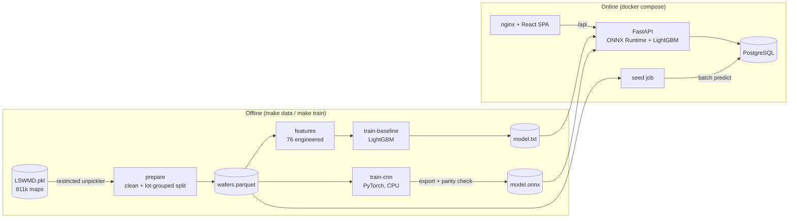

# Design notes

This document explains *why* the system is built the way it is. The README covers what it does
and the results.

## 1. Goals and non-goals

**Goals**

- Classify wafer test maps into the nine WM-811K failure-pattern classes, with an evaluation
  protocol a fab engineer would trust: lot-grouped splits, one look at the test set, uncertainty on
  the headline number.
- Serve the classifier behind a typed HTTP API, together with the lot, wafer and yield queries an
  engineer needs to triage a lot.
- A UI that shows a die-level wafer map at full resolution and lets you upload a new map.
- One-command start (`docker compose up`), with every number in the README reproducible by a
  `make` target.

**Non-goals (deliberately left out)**

- Authentication / multi-tenancy. The API is read-mostly and the only write path is `save=true` on
  prediction. A production deployment would sit behind the fab's SSO (OIDC) with per-role scopes.
- Real-time streaming from testers. Ingest is a batch job, the usual pattern for end-of-line
  wafer sort data, which arrives per lot.
- Root-cause linkage (tool, chamber, recipe). WM-811K carries no process history; see §8.

## 2. Architecture

Training and serving have different dependencies on purpose. The API image does not contain
PyTorch, pandas, scikit-learn or matplotlib: the CNN is exported to ONNX and run with ONNX Runtime
(43 MB installed, against 489 MB for the PyTorch CPU build, both measured in the dev venv), and the
parquet ingest uses `pyarrow` directly. The API image is 281 MB compressed.

## 3. Data pipeline

| Decision | Why |
|---|---|
| **Restricted unpickler** (`data/safe_pickle.py`) | `LSWMD.pkl` is a 2015 Python-2 pandas pickle from a third-party mirror. `pickle.load` would run any callable the file names. The unpickler resolves an allow-list of ~10 numpy/pandas reconstruction helpers and remaps the legacy module paths; anything else raises. The file's SHA-256 is pinned too. |
| **Drop maps with < 100 dies** | 67 maps (4 labelled) are sensor artefacts with 3–99 dies, too small to be real wafers. The threshold sits below the 1st percentile of labelled maps (500 dies). |
| **Keep complete lots that contain any labelled wafer** (245k wafers, 10,762 lots) | The lot view would look broken if only the labelled wafers of a lot were shown. Unlabelled wafers get model predictions at ingest. `--scope all` keeps all 811k. |
| **Lot-grouped, label-stratified 70/15/15 split** (`StratifiedGroupKFold`) | Wafers in one lot share process history and often the same defect. A random wafer-level split leaks near-duplicates into test and inflates scores. No lot appears in two splits (unit-tested). The dataset's own `Training/Test` column is kept for reference but not used, because it is not lot-grouped. |
| **Canonical 64×64 grid via exact area resampling** (`wafer.canonical`) | WM-811K has 632 distinct die-grid shapes (25×27 up to 300×202). Resampling to a fixed grid makes features and the CNN independent of die size. Area averaging (integral image) preserves the fail *fraction* exactly, which a nearest-neighbour resize does not (unit-tested on 8 to 300 px inputs). |
| **Parquet, maps as zlib-compressed bytes** | 245k maps = 46 MB on disk; columnar reads for training; the same bytes go into the DB `LargeBinary` column without re-encoding. |

## 4. Models

### Baseline: engineered features + LightGBM

76 features on the canonical grid: radial-ring / outer-sector / 3×3 density, the across-angle
mean and std of the Radon transform (a scratch gives a sharp, angle-specific peak), and the
geometry of the largest connected fail cluster on the original grid (area, perimeter, axes,
eccentricity, solidity, centroid radius). Connected components run on the original grid because
resampling would merge or split clusters.

Hyper-parameters (class-weight exponent α ∈ {0, 0.5, 1} × leaves ∈ {31, 63}) are chosen on
validation macro-F1 with early stopping. Validation chose **α = 0, no re-weighting** (validation
macro-F1 0.889 vs 0.881 for α = 0.5 and 0.838–0.858 for α = 1; all trials are in
`reports/metrics/baseline.json`). On a 'none'-dominated distribution, re-weighting bought minority
recall at too high a cost in false alarms. This is reported as a finding, not hidden.

### CNN

Four conv blocks (16-32-64-128), global average pooling, 0.29 M parameters, ~55 M MACs per wafer.
Input: two channels (die coverage, fail coverage), quantised to uint8 so the training cache and
the serving input are bit-identical.

Imbalance handling:

1. **Square-root sampling**: class mass ∝ √n_c per epoch. Near-full goes from 0.09 % to 1.5 % of
   draws and 'none' from 85 % to 48 %. Full balancing was rejected for the same reason as α = 1
   above.
2. **Dihedral augmentation** (4 rotations × flip). WM-811K classes are defined by radial and local
   shape, not absolute orientation, so these transforms preserve the label.
3. **Label smoothing 0.05**, because the labels are known to be noisy at the Loc/Edge-Loc and
   Center/Loc borders.

The epoch is chosen by validation macro-F1 (early stopping, patience 6). The exported ONNX model
is checked against PyTorch on 512 test inputs (max |Δlogit| is stored in `meta.json`).

### Why macro-F1, and why a lot bootstrap

Accuracy is meaningless here: predicting 'none' for everything scores 85 %. Macro-F1 weights the
21-wafer Near-full class the same as the 22k-wafer 'none' class, which matches the engineering
reality that rare signatures (Near-full: a dead tester or a gross process excursion) are the
expensive ones. The 95 % CI resamples *lots*, not wafers, because wafers within a lot are
correlated.

## 5. Serving

- **Model registry** (`ml/predict.py`) discovers `models/<name>/meta.json` + weights. The model
  version is the first 12 hex chars of the weight file's SHA-256, so a prediction row records
  exactly which bytes produced it. (Weights are written with LF line endings so the hash does not
  depend on the OS that wrote them.)
- **Batch predictions at ingest, on-demand for the baseline.** The CNN is cheap: 6.0 ms median for a
  single wafer and 194 wafers/s in a batch on a heavily loaded laptop (`reports/metrics/latency.json`).
  Inside Docker the seed job ingested and labelled all 244,841 wafers in 195 s (about 1,250 wafers/s,
  including decode and PostgreSQL inserts). So every wafer gets a stored prediction and the analytics
  queries are plain SQL. The baseline's feature extraction (Radon transform + region properties) is
  roughly 10× slower per wafer (57 ms median), so it runs only on request (`/predict?model=baseline`,
  or "Classify with baseline" in the UI).
- **Denormalised lot aggregates** (`lots.wafer_count`, `lots.mean_yield`), refreshed by one
  `UPDATE … (SELECT …)` after ingest or upload. A lot list page never scans the wafer table.
- **Deferred blob column**: `wafers.map_zlib` is `deferred()`, so list endpoints never load it.
  `/wafers/{id}/map` is the only path that decodes a map.

## 6. API

- Versioned prefix `/api/v1`; OpenAPI at `/docs`.
- Every list endpoint returns `{items, total, page, page_size, pages}`. `page_size ≤ 200` is
  enforced by validation, not silently clamped.
- Enum-typed query parameters (`pattern`, `source`, `sort`, `model`), so a typo returns 422 with a
  message instead of an empty result. No user input reaches SQL as text; sort columns come from a
  `Literal` type.
- **Upload hardening**: 2 MiB cap (413), `.npy` parsed with `allow_pickle=False` (an object-array
  `.npy` is rejected, tested), bin codes and shape validated (≤ 512 per side, ≥ 100 dies), and the
  parser is chosen by extension, so content sniffing cannot be fooled.
- Uploads are stored in a dedicated lot `uploads` with `source='upload'` and are excluded from the
  production yield trend.

## 7. Frontend

- **Canvas** wafer renderer: a 300×205 map has 61k dies; one canvas draws it in a few ms, where
  61k DOM nodes would not. HiDPI-aware, with an ARIA label summarising the map for screen readers.
- **URL is the state** for filters and paging (`?pattern=Scratch&page=3`), so views are shareable
  and screenshots are reproducible.
- `useApi` aborts the previous request when its inputs change, so a slow page can never overwrite
  a newer one. Loading state is derived, with no synchronous `setState` in effects.
- Route-level code splitting: the overview chunk (108 kB gzip, mostly recharts) loads only with
  the overview page; the other pages are 1–3 kB each on top of the 84 kB core bundle.

## 8. Limitations and what would change in a real fab

- **No time axis.** WM-811K has no timestamps, so the "yield trend" uses lot-number order as a proxy
  for production sequence. In production this would be the lot's sort date, and the trend would
  be per product / technology node.
- **No process context.** Real triage joins defect signatures to tool, chamber and recipe history
  (e.g. an Edge-Ring burst on one etch chamber). The schema has a place for it (lots → wafers), but
  the data does not.
- **Label noise and a closed label set.** WM-811K labels come from a single labelling campaign. A new
  failure signature would be forced into one of nine classes; a production system needs an
  "unknown" route (low max-probability / out-of-distribution score → human review queue).
- **Scale.** 245k wafers fit comfortably in PostgreSQL. At tens of millions of wafers per year:
  partition `wafers` by sort month, move map blobs to object storage keyed by wafer id, compute
  lot aggregates incrementally in the ingest worker, and replace the seed job with a queue-driven
  consumer (one message per lot from the tester data pipeline).

## 9. Alternatives considered

| Option | Why not (here) |
|---|---|
| Random wafer-level split | Leaks lot-mates across splits. Measured on this dataset, it did *not* inflate the baseline (0.880 random vs 0.887 lot-grouped, `reports/metrics/split_leakage.json`), but there is no guarantee for other models or data, and the grouped split costs nothing. |
| Pretrained ResNet / transfer learning | 11 M+ parameters for 64×64 two-channel maps; too slow to train on the available CPU. The 0.3 M-parameter CNN already matches the baseline, and its best epoch was the last one, so a longer schedule should come first. Worth trying with a GPU. |
| Serving PyTorch directly | ~10× larger image and slower cold start; ONNX Runtime gives the same logits (parity-checked). |
| SQLite in production | Fine for a single user (it is the local default and the test DB); compose uses PostgreSQL for concurrent writers and to prove the migrations are portable (CI runs the API tests on both). |
| One `
` per die | Simple, but the DOM falls over on 60k-die maps × 25 thumbnails. |
