# Wafer-map defect analytics

A full-stack platform that ingests wafer test maps, classifies their spatial failure pattern
with machine learning, and serves lot- and yield-level analytics through a typed REST API and a
React UI. It is built on WM-811K, a public dataset of 811,457 real wafer maps from production.

**Stack:** Python 3.12 · FastAPI · SQLAlchemy 2 + Alembic · PostgreSQL / SQLite · LightGBM ·
PyTorch → ONNX Runtime · React 19 + TypeScript (Vite) · Docker Compose · GitHub Actions

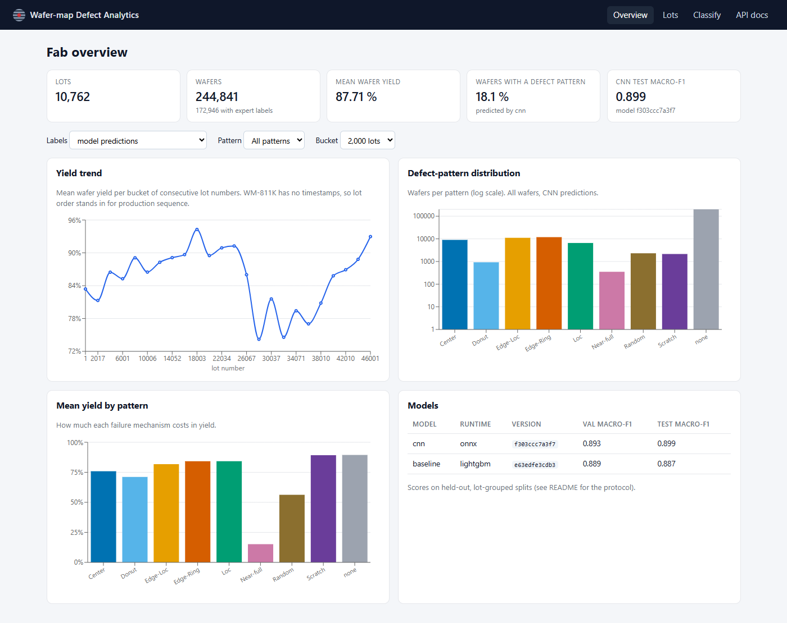

---

## 1. Problem: why wafer-map patterns matter

After front-end processing, every die on a wafer is electrically tested at wafer sort. The result
is a *wafer map*: a grid of pass/fail dies. Yield engineers rarely look at the yield number alone.
The **spatial signature** of the failing dies points to the process step that caused them:

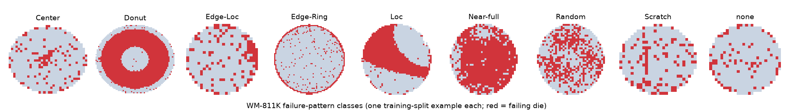

| Pattern | Typical root-cause family |
|---|---|
| Center | radial non-uniformity in deposition / CMP / etch, centre-hot chucks |
| Donut | ring-shaped non-uniformity (e.g. spin-coat, thermal profile) |
| Edge-Ring | edge exclusion problems, edge bead, etch/CMP edge effects |
| Edge-Loc | localised edge damage: handling, clamp/ring contact |
| Loc | local contamination or a defect cluster |
| Scratch | mechanical damage (handling, CMP) – a line or arc |
| Random | particle-driven random defectivity |
| Near-full | gross failure: wrong recipe, tester/probe-card issue |
| none | no systematic pattern |

Classifying maps automatically lets a fab route an excursion to the right module (litho, etch,
CMP, handling) within minutes of sort instead of after a manual review, and spot a signature
spreading across lots before it costs a full lot of wafers.

The hard parts are the ones a real fab has too: **extreme class imbalance** (85 % of labelled
maps are 'none'; Near-full has 149 examples, **989 : 1**), 632 different die-grid sizes, noisy
labels, and correlated wafers within a lot.

## 2. Architecture

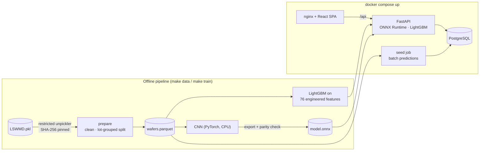

| Component | Path | Notes |
|---|---|---|
| Data pipeline | `backend/src/wafermap/data/` | safe loading, cleaning, splits, imbalance report |
| Features + models | `backend/src/wafermap/features/`, `ml/` | baseline, CNN, metrics, ONNX export, report |
| Database | `backend/src/wafermap/db/`, `backend/alembic/` | SQLAlchemy 2 models, Alembic migrations, ingest |
| API | `backend/src/wafermap/api/` | FastAPI routers, Pydantic schemas, OpenAPI |
| Frontend | `frontend/src/` | React + TS, canvas wafer viewer, recharts |
| Ops | `docker-compose.yml`, `*/Dockerfile`, `Makefile`, `.github/workflows/ci.yml` | |

Design decisions and trade-offs are in **[DESIGN.md](DESIGN.md)**.

## 3. Data

`make data` downloads `LSWMD.pkl` (2.1 GB, SHA-256 verified; see [DATA_LICENSE.md](DATA_LICENSE.md)),
loads it with a **restricted unpickler** (the file is a Python-2 pandas pickle from a public mirror,
and plain `pickle.load` would execute arbitrary code), cleans it and writes `data/processed/`.
The raw data is never committed.

| | Count |
|---|---:|
| Raw wafer maps | 811,457 |
| Dropped (fewer than 100 dies: sensor artefacts) | 67 (of which labelled: 4) |
| Labelled wafers kept | 172,946 |
| Wafers ingested (all wafers of the 10,762 lots that contain a labelled wafer) | 244,841 |
| Train / val / test wafers (lots) | 121,067 (7,524) / 25,943 (1,618) / 25,936 (1,620) |
| Largest / smallest class | none 147,427 / Near-full 149 → **989.4 : 1** (65.0 : 1 among defect classes) |

Per-class counts and shares are in [`reports/metrics/dataset_summary.json`](reports/metrics/dataset_summary.json).

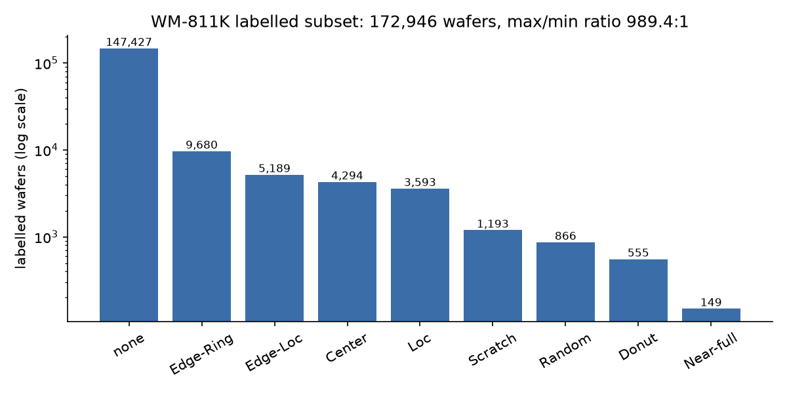

**Split protocol.** Labelled wafers are split 70 / 15 / 15 **by lot** (`StratifiedGroupKFold`,
label-stratified): no lot appears in two splits. Wafers from one lot share process history, so a
random wafer-level split would leak near-duplicates into the test set. Hyper-parameters and
epochs are selected on validation only; the test split is scored once per model, at the end of
its training script.

## 4. Models and results

Two models, the same splits, the same protocol: select on validation macro-F1, score test once.

| | Baseline | CNN |
|---|---|---|
| Input | 76 engineered features (radial / sector / grid fail density, Radon-transform profile, largest-cluster geometry) | 2 × 64 × 64 canonical map (die coverage, fail coverage) |
| Model | LightGBM, 179 trees × 9 classes | 4-block CNN, 295,017 parameters |
| Imbalance handling | class-weight exponent α ∈ {0, 0.5, 1} chosen on validation → **α = 0.0** | √-frequency sampling, dihedral augmentation, label smoothing |
| Training (laptop CPU) | 6-config grid, 5 min | 12 epochs, 114 min, best epoch 12 |
| Serving | LightGBM + feature extraction | ONNX Runtime (max \|Δlogit\| vs PyTorch: 4.1e-06) |

| Model | Val macro-F1 | Test macro-F1 [95 % lot-bootstrap CI] | Test macro-F1 (8 defect classes) | Test balanced acc. | Test accuracy | Latency, 1 wafer (median) | Batch throughput (wafers/s) |
|---|---:|---:|---:|---:|---:|---:|---:|
| baseline | 0.889 | **0.887** [0.862, 0.902] | 0.874 | 0.862 | 0.979 | 57.2 ms | 18 |
| cnn | 0.893 | **0.899** [0.879, 0.913] | 0.887 | 0.924 | 0.977 | 6.0 ms | 194 |

Test split: 25,936 wafers from held-out lots. Latency measured on `Intel64 Family 6 Model 183 Stepping 1, GenuineIntel`, single process, CPU only.

| Class | Test support | Baseline P / R / F1 | CNN P / R / F1 |
|---|---:|---|---|
| Center | 644 | 0.949 / 0.933 / **0.941** | 0.897 / 0.952 / **0.924** |
| Donut | 84 | 0.899 / 0.738 / **0.810** | 0.884 / 0.905 / **0.894** |
| Edge-Loc | 779 | 0.858 / 0.847 / **0.853** | 0.820 / 0.877 / **0.847** |
| Edge-Ring | 1,452 | 0.988 / 0.977 / **0.982** | 0.983 / 0.971 / **0.977** |
| Loc | 540 | 0.818 / 0.776 / **0.797** | 0.766 / 0.841 / **0.801** |
| Near-full | 21 | 1.000 / 0.905 / **0.950** | 1.000 / 0.952 / **0.976** |
| Random | 131 | 0.877 / 0.924 / **0.900** | 0.804 / 0.970 / **0.879** |
| Scratch | 179 | 0.881 / 0.665 / **0.758** | 0.745 / 0.866 / **0.801** |
| none | 22,106 | 0.989 / 0.994 / **0.992** | 0.994 / 0.986 / **0.990** |

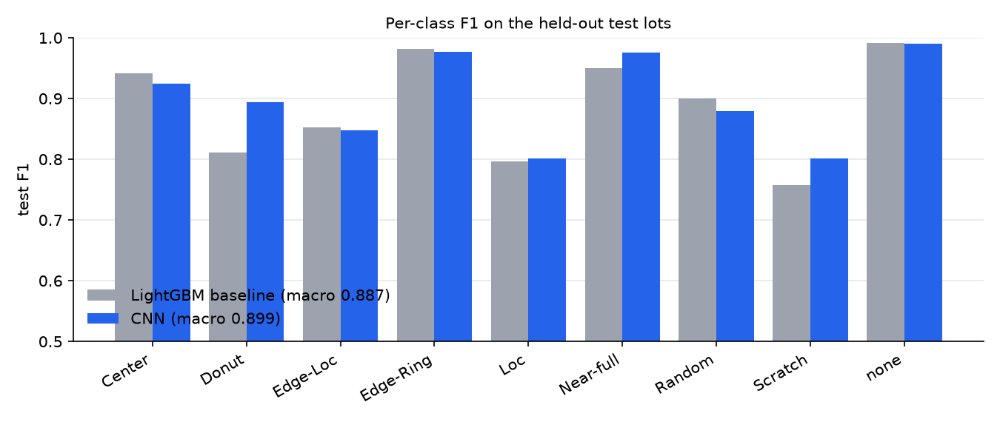

| CNN confusion matrix (test) | Baseline confusion matrix (test) |
|---|---|
| 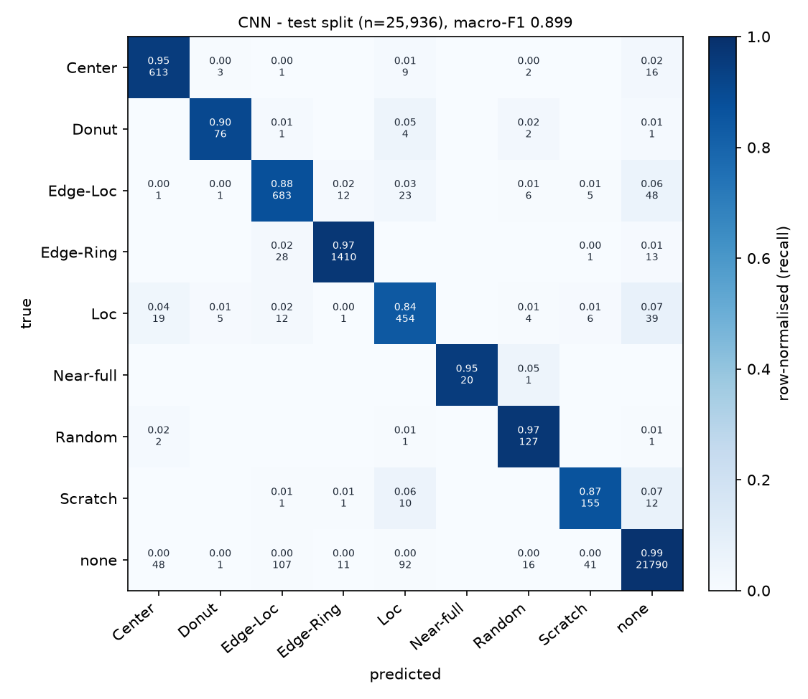 | 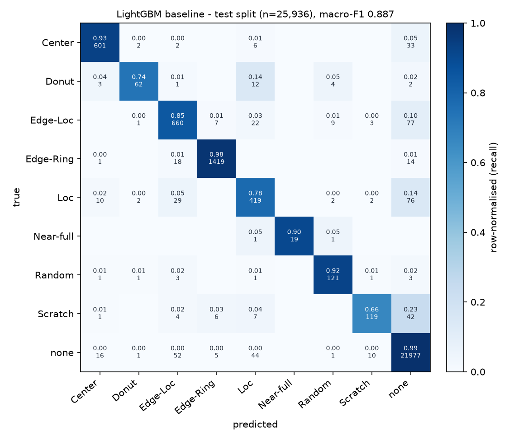 |

**Reading the results**

- The CNN is ahead on macro-F1 (0.899 vs 0.887), but the lot-bootstrap
  intervals overlap, so the honest statement is *comparable, CNN slightly ahead*. The clearer
  difference is **balanced accuracy, 0.924 vs 0.862**: the CNN finds far more of the rare
  patterns (Scratch recall 0.87 vs 0.66, Donut 0.90 vs 0.74) and pays for it
  with lower precision on Loc and Scratch. For yield triage, missing a scratch is usually worse
  than a false alarm a human can dismiss in a second, so the CNN is the default model.
- The remaining errors sit where the label definitions overlap: Loc ↔ Edge-Loc ↔ none, and Center ↔ Loc.
  WM-811K "none" wafers can carry small clusters of failing dies (see the example in §1), so some
  of these cells are likely label ambiguity rather than model error.
- **Speed:** the CNN classifies one wafer in 6.0 ms (median) versus
  57.2 ms for the feature pipeline, which is what makes batch-labelling all ingested wafers at load time
  practical. Measured on a busy, shared laptop CPU ([`latency.json`](reports/metrics/latency.json)), so treat the absolute values as
  pessimistic.
- **Does the lot-grouped split matter here?** Measured, not assumed
  ([`split_leakage.json`](reports/metrics/split_leakage.json)): the same baseline configuration on a
  *random* wafer-level split scores 0.880 (CI 0.863–0.894), with
  7,374 of 7,753 test lots also present in training, versus 0.887 lot-grouped. On WM-811K
  the leak does **not** measurably inflate this model's score. The lot-grouped protocol is kept anyway,
  because it is the one that matches deployment (new lots) and it costs nothing.

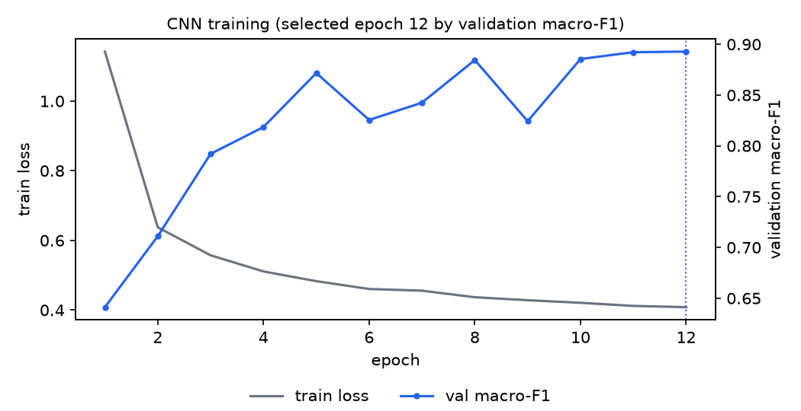

The best epoch was the last one, so a longer schedule (or a GPU) would probably still help; the
12-epoch schedule was chosen to fit the CPU budget, not tuned.

## 5. Engineering decisions and trade-offs

The full list is in [DESIGN.md](DESIGN.md). The ones that changed the outcome most:

- **Lot-grouped splits + lot-level bootstrap CI.** The evaluation simulates the real use case, new
  lots. The leakage experiment above shows that on this dataset a random split would not have
  flattered the baseline, so this is a check that passed, not a fix. The CI shows how much
  of the gap between the two models is noise (most of it).
- **Training/serving split of dependencies.** The CNN is exported to ONNX and served with ONNX
  Runtime; the API image has no PyTorch. A parity test checks that the exported model gives the
  same logits as PyTorch.
- **Validation-selected imbalance handling.** The baseline grid included full class balancing
  (α = 1); validation rejected it (0.838–0.858 vs 0.889 unweighted). On a fab-realistic 85 % 'none'
  distribution, balancing buys minority recall at too high a cost in false alarms. The CNN therefore
  uses a middle ground, √-frequency sampling plus augmentation. That choice was a design decision,
  not grid-searched, given the CPU budget.
- **Batch predictions at ingest, on-demand baseline.** The fast CNN pre-labels all 245k wafers
  (the Docker seed job ingested and labelled 244,841 wafers in 195 s), so analytics are plain SQL;
  the ~10× slower feature pipeline only runs when someone asks.
- **Security-minded ingestion.** Restricted unpickler, pinned dataset hash, `.npy` uploads parsed with
  `allow_pickle=False`, 2 MiB upload cap, enum-validated query parameters.
- **Portable persistence.** One set of Alembic migrations runs on SQLite (local, tests) and
  PostgreSQL (compose, CI job).

## 6. Limitations

- **Time is a proxy.** WM-811K has no timestamps; the yield trend orders lots by lot number.
- **No process context** (tool, chamber, recipe), so the system classifies signatures but cannot
  attribute them to equipment.
- **Closed label set.** A novel signature is forced into one of nine classes. Production would add
  an out-of-distribution / low-confidence route to human review.
- **Label quality.** WM-811K labels are known to be noisy at class borders (Loc vs Edge-Loc,
  Center vs Loc); the confusion matrices show exactly these confusions.
- **Single dataset, single fab.** No claim is made about transfer to other products or die sizes
  without retraining.
- **No auth.** The API is open; see DESIGN.md §1 for how it would be secured.

## 7. Screenshots

All captured from the Docker Compose stack (`docker compose up`) with the full dataset ingested,
by `scripts/screenshots.py`.

**Fab overview**: KPIs, yield trend along the lot sequence, pattern distribution, yield by pattern, model versions.


**Lots filtered by pattern** (`/lots?pattern=Scratch`): server-side pagination, sort and filter.
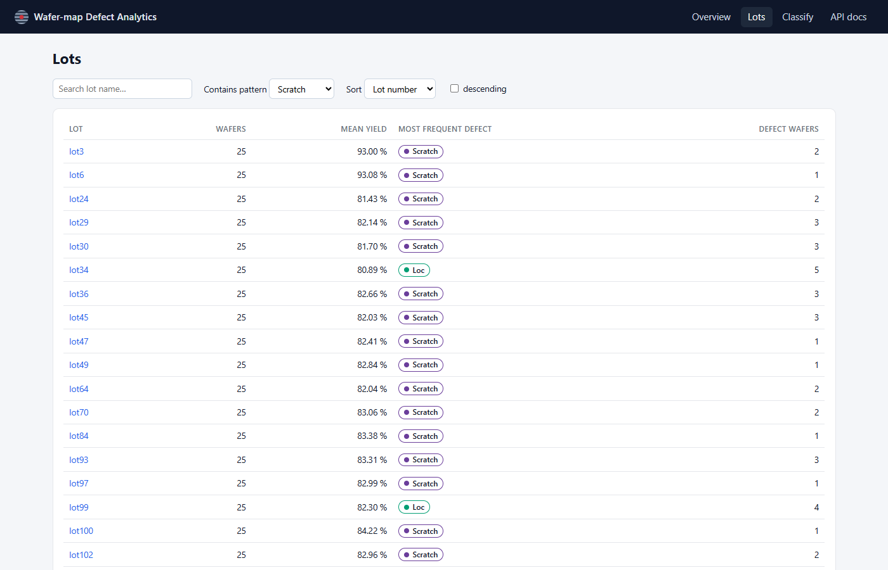

**Lot drill-down**: every wafer of the lot as a die-level thumbnail with the CNN label; red outline = disagrees with the expert label.
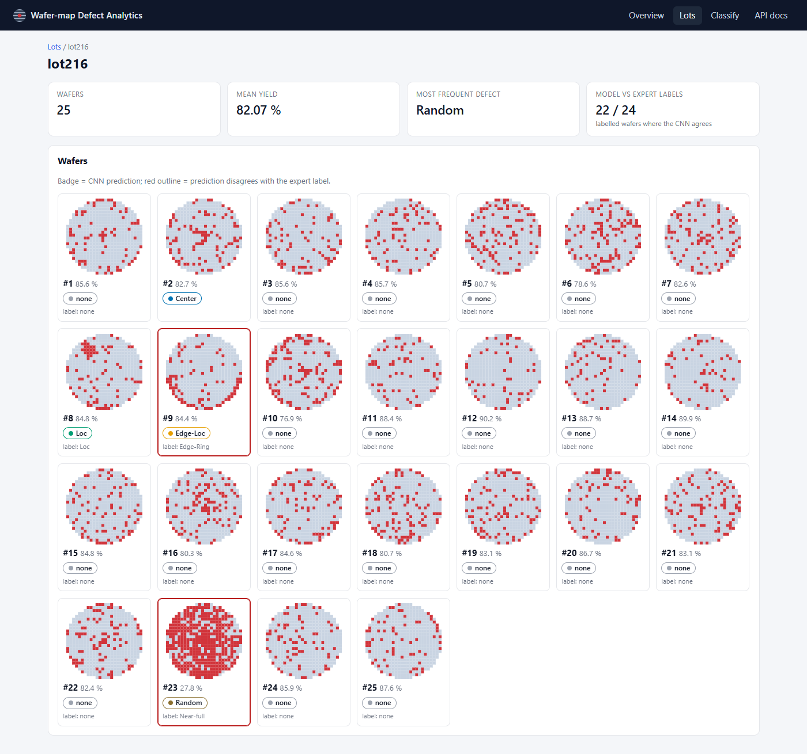

**Wafer detail**: interactive die-level map (hover shows row / column / bin), expert label, CNN probabilities, on-demand baseline.
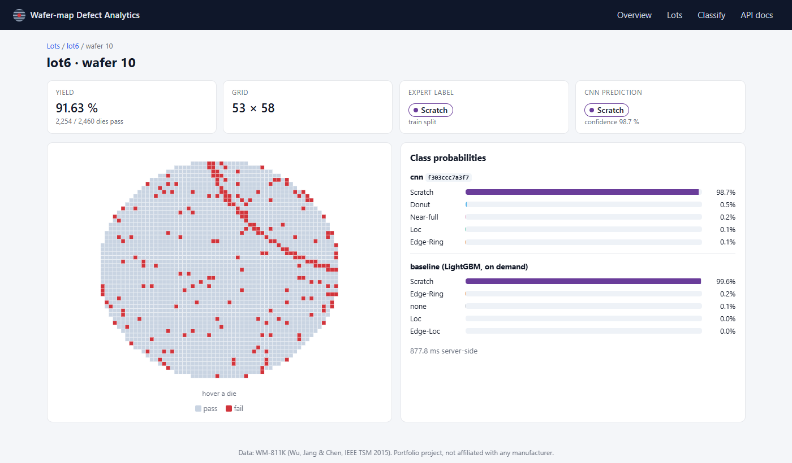

**Upload + live classification** of a new map (synthetic Donut sample).
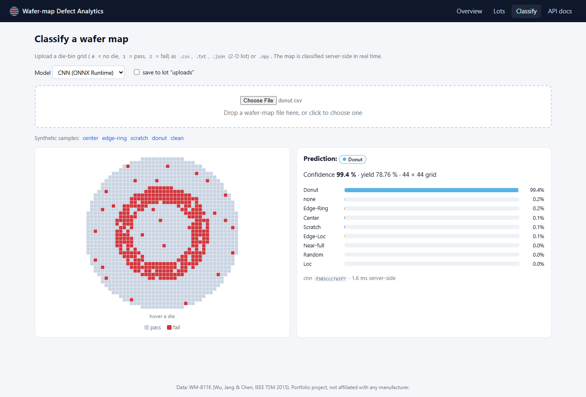

**OpenAPI docs** generated from the typed FastAPI endpoints.
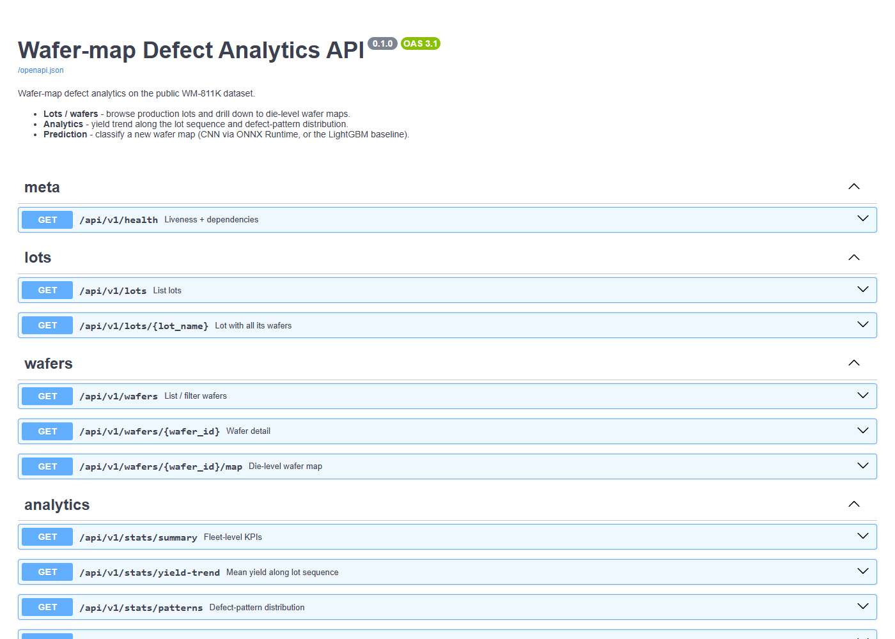

## 8. How to run

### Option A: Docker (one command)

Requires Docker with Compose v2. Trained models are committed, so no training is needed.

```bash
python scripts/fetch_dataset.py        # 2.1 GB, SHA-256 verified (skip to start with an empty DB)
cd backend && uv sync --extra ml && uv run wafermap prepare && cd ..
docker compose up --build
```

- UI: <http://localhost:8080> · API docs: <http://localhost:8000/docs>
- The `seed` service waits for the API (which applies the migrations), ingests
  `data/processed/wafers.parquet` into PostgreSQL with CNN predictions, and exits. It does nothing on
  later restarts (`--if-empty`). Set `SEED_LIMIT_LOTS=500` in `.env` for a quicker partial demo.
- Without the dataset, the stack still starts with an empty database; the **Classify** page works
  on uploaded maps (synthetic samples are built in).

### Option B: local, without Docker (SQLite)

Requires Python 3.12 with [uv](https://docs.astral.sh/uv/), and Node 20+.

```bash
make install            # uv sync --extra ml  +  npm ci
make data               # fetch + prepare
make ingest             # alembic upgrade head + load ~245k wafers into data/wafermap.db
make api                # http://127.0.0.1:8000/docs
make web                # http://localhost:5173 (proxies /api to :8000)
```

On Windows without `make`, run the commands in the `Makefile` directly, e.g.
`cd backend && uv run wafermap ingest`.

### Reproduce the models and every number in this README

```bash
make train              # features -> LightGBM baseline -> CNN (CPU) + ONNX export
cd backend && uv run wafermap report     # summary.md, latency.json, figures
uv run python ../scripts/split_leakage_experiment.py
```

All outputs land in `models/` and `reports/`; the README tables are copied from
`reports/metrics/summary.md`. Seeds are fixed (`WAFERMAP_SEED=42`). The CNN was trained on a laptop
CPU; PyTorch CPU kernels are not bit-for-bit deterministic across machines, so expect small
deviations in the last digit.

### Tests and quality gates

```bash
make test               # pytest (backend, SQLite) + vitest (frontend)
make lint               # ruff, ruff format --check, mypy --strict, eslint, prettier --check
```

CI (`.github/workflows/ci.yml`) runs the same gates, repeats the API tests against PostgreSQL, builds both images and
smoke-tests the compose stack.

### API at a glance

| Method | Path | Purpose |
|---|---|---|
| GET | `/api/v1/lots` | paginated lots; filter by pattern / yield / name, sort |
| GET | `/api/v1/lots/{lot}` | lot detail with all wafers and per-pattern counts |
| GET | `/api/v1/wafers` | paginated wafers; filter by lot, pattern (true or predicted), yield |
| GET | `/api/v1/wafers/{id}` · `/map` | wafer detail + predictions · die-level grid |
| POST | `/api/v1/predict` | classify a JSON grid (`?model=cnn\|baseline&save=bool`) |
| POST | `/api/v1/predict/upload` | classify an uploaded `.csv/.txt/.json/.npy` map |
| GET | `/api/v1/stats/summary` · `/yield-trend` · `/patterns` | KPIs, yield along lot sequence, pattern distribution |
| GET | `/api/v1/models` · `/health` | loaded model versions + scores · liveness |

```bash
curl -s -X POST "http://localhost:8000/api/v1/predict/upload?model=cnn" \
     -F "file=@frontend/public/samples/edge-ring.csv"
```

## 9. Repository layout

```
backend/            Python package `wafermap` (pipeline, models, API), Alembic, tests, Dockerfile
frontend/           React + TypeScript app, vitest tests, nginx config, Dockerfile
models/             committed model weights + meta (version = SHA-256 prefix of the weights)
reports/            generated metrics (JSON / Markdown) and figures quoted in this README
scripts/            dataset fetch, screenshots, synthetic sample maps
docs/screenshots/   UI screenshots
```

## Acknowledgements

Dataset: M.-J. Wu, J.-S. R. Jang and J.-L. Chen, "Wafer Map Failure Pattern Recognition and
Similarity Ranking for Large-Scale Data Sets", *IEEE Trans. Semiconductor Manufacturing* 28(1),
2015. This is an independent portfolio project, not affiliated with any semiconductor manufacturer.

Code licence: MIT.
