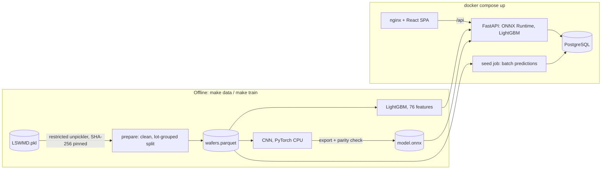

# Wafer-map defect analytics

Classifies the spatial failure pattern of wafer test maps (Center, Edge-Ring, Scratch, ...) on
the public WM-811K dataset, and serves lot and yield analytics through a FastAPI backend and a
React UI. The pattern on a wafer map points to the process step that caused the failures, so
labelling every map automatically is how excursions get routed to the right module quickly.

| Model | Test macro-F1, 9 classes [95 % lot-bootstrap CI] | Macro-F1, 8 defect classes | Balanced accuracy | Latency, 1 wafer |
|---|---:|---:|---:|---:|
| LightGBM on 76 engineered features | 0.887 [0.862, 0.902] | 0.874 | 0.862 | 12.5 ms |
| CNN, 0.3 M parameters, served with ONNX Runtime | **0.899** [0.879, 0.913] | **0.887** | **0.924** | **0.7 ms** |

25,936 test wafers from 1,620 lots that the models never saw during training or tuning. The CNN
is ahead by 0.012 macro-F1, but the paired lot-bootstrap interval for that difference is
[-0.007, +0.033], so on this test set the two models are not separable on macro-F1. They differ
clearly in where they make mistakes (see [Error analysis](#error-analysis)).


```bash
docker compose up --build        # UI http://localhost:8080, API docs http://localhost:8000/docs
```

This starts PostgreSQL, the API and the UI with the committed models. Without the dataset the
database is empty and the Classify page works on uploaded maps; [How to run](#how-to-run)
covers loading all 245k wafers.

## Architecture



| Part | Path |
|---|---|
| Data pipeline: safe loading, cleaning, lot-grouped splits | `backend/src/wafermap/data/` |
| Features, models, metrics, report | `backend/src/wafermap/features/`, `backend/src/wafermap/ml/` |
| Database: SQLAlchemy 2, Alembic (SQLite and PostgreSQL) | `backend/src/wafermap/db/`, `backend/alembic/` |
| API: FastAPI, Pydantic schemas, OpenAPI | `backend/src/wafermap/api/` |
| UI: React 19, TypeScript, canvas wafer viewer | `frontend/src/` |
| Committed models and generated metrics | `models/`, `reports/` |

## Data and evaluation protocol

WM-811K has 811,457 wafer maps from real production, 172,950 of them labelled with one of nine
classes. The data is not in this repository: `scripts/fetch_dataset.py` downloads it and checks
its SHA-256 (source and terms in [DATA_LICENSE.md](DATA_LICENSE.md)).

- **Imbalance.** 85.2 % of labelled maps are `none`; Near-full has 149 examples, a 989 : 1
  ratio (65 : 1 among the defect classes). Accuracy is therefore not a useful headline:
  predicting `none` everywhere scores 85 %.
- **Cleaning.** 67 maps with fewer than 100 dies are dropped (4 labelled). Every wafer of every
  lot that has a labelled wafer is kept, 244,841 wafers in 10,762 lots, so the lot views are
  complete; unlabelled wafers get model predictions at ingest.
- **Split.** Labelled wafers are split 70 / 15 / 15 **by lot** (`StratifiedGroupKFold`,
  stratified by label): 121,067 / 25,943 / 25,936 wafers. Wafers in a lot share process history,
  so no lot appears in two splits (unit-tested).
- **Selection.** Hyper-parameters and the CNN epoch are chosen on validation macro-F1. Each
  training script scores the test split once, after selection.
- **Metric.** Macro-F1 over all nine classes, `none` included, so every rare pattern counts as
  much as the clean class. The 8-defect-class average is reported next to it. Confidence
  intervals resample whole lots (1,000 resamples), because wafers within a lot are correlated.

All counts are in [`reports/metrics/dataset_summary.json`](reports/metrics/dataset_summary.json).

## Models

| | LightGBM baseline | CNN |
|---|---|---|
| Input | 76 features on a 64 x 64 resampled map: radial, sector and grid fail density, Radon-transform profile, largest-cluster geometry | 2 x 64 x 64 map (die coverage, fail coverage) |
| Size | 179 boosting rounds x 9 classes | 4 conv blocks, 295,017 parameters |
| Imbalance | class-weight exponent chosen on validation: none (α = 0) | square-root class sampling, 8-fold dihedral augmentation, label smoothing 0.05 |
| Training, laptop CPU | 6-configuration grid, 5 min | 12 epochs, 114 min |
| Serving | feature extraction + LightGBM | ONNX Runtime, no PyTorch in the image; max logit difference to PyTorch 4.1e-6 |

Per-class test results (precision / recall / F1):

| Class | Test wafers | LightGBM | CNN |
|---|---:|---|---|
| Center | 644 | 0.949 / 0.933 / **0.941** | 0.897 / 0.952 / **0.924** |
| Donut | 84 | 0.899 / 0.738 / **0.810** | 0.884 / 0.905 / **0.894** |
| Edge-Loc | 779 | 0.858 / 0.847 / **0.853** | 0.820 / 0.877 / **0.847** |
| Edge-Ring | 1,452 | 0.988 / 0.977 / **0.982** | 0.983 / 0.971 / **0.977** |
| Loc | 540 | 0.818 / 0.776 / **0.797** | 0.766 / 0.841 / **0.801** |
| Near-full | 21 | 1.000 / 0.905 / **0.950** | 1.000 / 0.952 / **0.976** |
| Random | 131 | 0.877 / 0.924 / **0.900** | 0.804 / 0.970 / **0.879** |
| Scratch | 179 | 0.881 / 0.665 / **0.758** | 0.745 / 0.866 / **0.801** |
| none | 22,106 | 0.989 / 0.994 / **0.992** | 0.994 / 0.986 / **0.990** |

Near-full has 21 test wafers, so one error moves its recall by 0.05; read that row as noise.

## Error analysis

| CNN, test split (row-normalised) | LightGBM, test split |
|---|---|
|  |  |

The two models make almost the same number of defect-vs-defect mistakes (162 and 163). The
difference is the boundary between "some defect" and `none`:

| Test split | LightGBM | CNN |
|---|---:|---:|
| Defect wafers called `none` (missed), of 3,830 | 247 (6.4 %) | **130 (3.4 %)** |
| `none` wafers called a defect (false alarm), of 22,106 | **129 (0.6 %)** | 316 (1.4 %) |

- The CNN halves the missed defects, mostly Scratch (recall 0.67 to 0.87) and Donut (0.74 to
  0.90), and pays with 2.4 times as many false alarms, mainly `none` read as Edge-Loc (107) or
  Loc (92). Square-root sampling shows the CNN `none` in 49 % of draws instead of 85 %, which
  moves its decision boundary towards "defect". For triage, a missed scratch costs more than a
  false alarm an engineer dismisses in a second, so the CNN is the default model.
- What remains for both is Loc, Edge-Loc and `none` bleeding into each other, plus Center vs Loc.
  WM-811K `none` maps often carry small fail clusters, so part of this is label ambiguity.
- **Calibration.** LightGBM probabilities are well calibrated (expected calibration error 0.004).
  The CNN is under-confident: mean top-class confidence 0.93 against 0.98 accuracy (ECE 0.047),
  an expected side effect of label smoothing and resampling. Its confidence is fine for ranking
  but should be temperature-scaled on validation before it drives a review threshold.

Numbers from [`comparison.json`](reports/metrics/comparison.json), produced by
`scripts/compare_models.py`. That script also re-runs both committed models on the test split
and confirms they reproduce the stored confusion matrices exactly.

**Does the lot-grouped split matter here?** I measured it rather than assumed it
([`split_leakage.json`](reports/metrics/split_leakage.json)): the same LightGBM configuration on a
random wafer-level split scores 0.880 [0.863, 0.894], with 7,374 of its 7,753 test lots also in
training, against 0.887 lot-grouped. On WM-811K the leak does not measurably inflate this model.
I kept the grouped split because it matches deployment (new lots) and costs nothing.

## Design decisions and trade-offs

Full reasoning in [DESIGN.md](DESIGN.md). The ones that mattered most:

- **Imbalance handling chosen on validation, not by default.** Full class re-weighting
  (α = 1) lost on validation (0.838 to 0.858 against 0.889 unweighted): on an 85 % `none`
  distribution it buys minority recall with too many false alarms. The CNN uses the middle
  ground, square-root sampling; that choice was not grid-searched, given the CPU budget.
- **Training and serving dependencies are separate.** The CNN is exported to ONNX; the API image
  has no PyTorch (ONNX Runtime is 43 MB installed, PyTorch CPU 489 MB) and a parity test checks
  the exported logits.
- **Batch predictions at ingest, baseline on demand.** At 0.7 ms per wafer the CNN pre-labels
  all 245k wafers during ingest, so the analytics are plain SQL. The feature pipeline is 18 times
  slower and runs only when a user asks for it.
- **Model versioning.** A model's version is the first 12 hex digits of its weight file's SHA-256,
  stored with every prediction and returned by `/api/v1/models`. Models are loaded and warmed up
  at startup, so the first request does not pay for it.
- **Defensive input handling.** Restricted unpickler for the legacy pickle, pinned dataset hash,
  `.npy` uploads parsed with `allow_pickle=False`, 2 MiB upload cap, bin codes and grid size
  validated (422 with a message), enum-typed query parameters.

Latency is the median of 200 single-wafer calls, from decoded grid to probabilities, on a
13th-gen Intel Core i5-13450HX laptop CPU ([`latency.json`](reports/metrics/latency.json)). The
Docker seed job ingests and labels all 244,841 wafers in 3 to 6 minutes on that laptop,
depending on what else is running.

## Limitations

- **No time axis.** WM-811K has no timestamps; the yield trend orders lots by lot number.
- **No process context** (tool, chamber, recipe), so signatures cannot be tied to equipment.
- **Closed label set.** A new signature is forced into one of nine classes. Production needs a
  low-confidence route to human review, which first needs the calibration fix above.
- **Label noise** at the Loc / Edge-Loc / `none` borders limits what any model can score.
- **One dataset.** No claim about transfer to other products or die sizes without retraining.
- **No authentication.** The API is open; DESIGN.md section 1 describes how it would be secured.

## Next steps

1. Temperature-scale the CNN on validation and add an "uncertain" route to the API.
2. Compare the two models at a matched false-alarm rate on `none`, so the comparison is not
   just two different operating points.
3. Train the CNN longer or on a GPU. Its validation curve was still rising at epoch 12 (0.886,
   0.892, 0.893 for epochs 10 to 12); with a one-cycle schedule the last epoch is expected to be
   best, so whether more epochs help is untested.

## How to run

**Requirements:** Docker with Compose v2. For the data and local development:
[uv](https://docs.astral.sh/uv/) (it installs Python 3.12 if needed) and Node 22.22+ or 24.15+.
The dataset needs 2.2 GB of disk (3.6 GB once the CNN training cache exists), and the `prepare`
step peaks at about 2.7 GB of RAM.

**Full stack with all 245k wafers**

```bash
python scripts/fetch_dataset.py                 # 2.1 GB download, SHA-256 verified
cd backend && uv sync --extra ml && uv run wafermap prepare && cd ..   # about 4 min
docker compose up --build
```

The `seed` service waits for the API (which applies the migrations), loads
`data/processed/wafers.parquet` into PostgreSQL with CNN predictions, and exits. Later restarts
skip it. `SEED_LIMIT_LOTS=500` in `.env` gives a quick partial load (see `.env.example`).

**Local, without Docker (SQLite)**

```bash
make install            # uv sync --extra ml, npm ci
make data               # fetch + prepare
make ingest             # migrations + load into data/wafermap.db
make api                # http://127.0.0.1:8000/docs
make web                # http://localhost:5173, proxies /api to :8000
```

Without GNU make, run the commands from the `Makefile` directly. The full SQLite ingest is
slow on Windows (23 min, against about 3 min into PostgreSQL); `--limit-lots 500` is quicker.
`make api` also works without the dataset and starts with an empty database.

**Reproduce the models and every number above**

```bash
make train              # features, LightGBM grid, CNN (CPU, about 2 h), ONNX export
make report             # summary.md, latency.json, figures, split-leakage and paired comparison
```

Outputs go to `models/` and `reports/`; the tables above are copied from
`reports/metrics/summary.md` and `comparison.json`. Seeds are fixed (`WAFERMAP_SEED=42`); PyTorch
CPU kernels are not bit-identical across machines, so a retrained CNN can differ in the last digit.

**Tests and checks**

```bash
make test               # pytest (SQLite) and vitest
make lint               # ruff, ruff format --check, mypy --strict, eslint, prettier --check
make typecheck          # mypy and tsc
```

CI (`.github/workflows/ci.yml`) runs the same checks, repeats the API tests on PostgreSQL, builds
both images and smoke-tests the stack. It has not run yet because the repository has not been
pushed; [docs/verification.md](docs/verification.md) has the local results.

## API

| Method | Path | Purpose |
|---|---|---|
| GET | `/api/v1/lots`, `/api/v1/lots/{lot}` | paginated lots (filter by pattern, yield, name), lot detail |
| GET | `/api/v1/wafers`, `/api/v1/wafers/{id}`, `/api/v1/wafers/{id}/map` | wafers, predictions, die-level grid |
| POST | `/api/v1/predict` | classify a JSON grid (`?model=cnn\|baseline&save=bool`) |
| POST | `/api/v1/predict/upload` | classify an uploaded `.csv`, `.txt`, `.json` or `.npy` map |
| GET | `/api/v1/stats/summary`, `/yield-trend`, `/patterns` | KPIs, yield along the lot sequence, pattern counts |
| GET | `/api/v1/models`, `/api/v1/health` | loaded model versions and scores, liveness |

```bash
curl -s -X POST "http://localhost:8000/api/v1/predict/upload?model=cnn" \
     -F "file=@frontend/public/samples/edge-ring.csv"
```

More screenshots: [lot list](docs/screenshots/02_lots_filtered.png),
[lot drill-down](docs/screenshots/03_lot_drilldown.png),
[wafer detail](docs/screenshots/04_wafer_detail.png),
[upload and classify](docs/screenshots/06_upload_classify.png),
[OpenAPI docs](docs/screenshots/05_api_docs.png).

## Acknowledgements

Dataset: M.-J. Wu, J.-S. R. Jang and J.-L. Chen, "Wafer Map Failure Pattern Recognition and
Similarity Ranking for Large-Scale Data Sets", *IEEE Trans. Semiconductor Manufacturing* 28(1),
2015. Independent project, not affiliated with any semiconductor manufacturer. Code: MIT licence.
