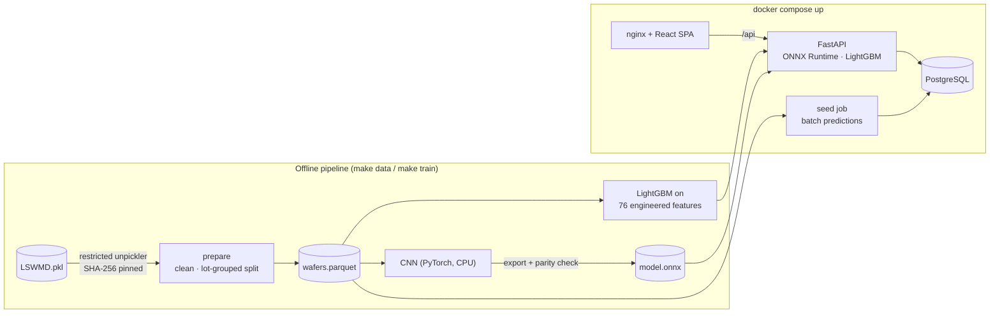

# Wafer-map defect analytics

A full-stack platform that ingests wafer test maps, classifies their spatial failure pattern
with machine learning, and serves lot- and yield-level analytics through a typed REST API and a
React UI. It is built on WM-811K, a public dataset of 811,457 real wafer maps from production.

**Stack:** Python 3.12 · FastAPI · SQLAlchemy 2 + Alembic · PostgreSQL / SQLite · LightGBM ·
PyTorch → ONNX Runtime · React 19 + TypeScript (Vite) · Docker Compose · GitHub Actions


---

## 1. Problem: why wafer-map patterns matter

After front-end processing, every die on a wafer is electrically tested at wafer sort. The result
is a *wafer map*: a grid of pass/fail dies. Yield engineers rarely look at the yield number alone.
The **spatial signature** of the failing dies points to the process step that caused them:


| Pattern | Typical root-cause family |
|---|---|
| Center | radial non-uniformity in deposition / CMP / etch, centre-hot chucks |
| Donut | ring-shaped non-uniformity (e.g. spin-coat, thermal profile) |
| Edge-Ring | edge exclusion problems, edge bead, etch/CMP edge effects |
| Edge-Loc | localised edge damage: handling, clamp/ring contact |
| Loc | local contamination or a defect cluster |
| Scratch | mechanical damage (handling, CMP) – a line or arc |
| Random | particle-driven random defectivity |
| Near-full | gross failure: wrong recipe, tester/probe-card issue |
| none | no systematic pattern |

Classifying maps automatically lets a fab route an excursion to the right module (litho, etch,
CMP, handling) within minutes of sort instead of after a manual review, and spot a signature
spreading across lots before it costs a full lot of wafers.

The hard parts are the ones a real fab has too: **extreme class imbalance** (85 % of labelled
maps are 'none'; Near-full has 149 examples, **989 : 1**), 632 different die-grid sizes, noisy
labels, and correlated wafers within a lot.

## 2. Architecture



| Component | Path | Notes |
|---|---|---|
| Data pipeline | `backend/src/wafermap/data/` | safe loading, cleaning, splits, imbalance report |
| Features + models | `backend/src/wafermap/features/`, `ml/` | baseline, CNN, metrics, ONNX export, report |
| Database | `backend/src/wafermap/db/`, `backend/alembic/` | SQLAlchemy 2 models, Alembic migrations, ingest |
| API | `backend/src/wafermap/api/` | FastAPI routers, Pydantic schemas, OpenAPI |
| Frontend | `frontend/src/` | React + TS, canvas wafer viewer, recharts |
| Ops | `docker-compose.yml`, `*/Dockerfile`, `Makefile`, `.github/workflows/ci.yml` | |

Design decisions and trade-offs are in **[DESIGN.md](DESIGN.md)**.

## 3. Data

`make data` downloads `LSWMD.pkl` (2.1 GB, SHA-256 verified; see [DATA_LICENSE.md](DATA_LICENSE.md)),
loads it with a **restricted unpickler** (the file is a Python-2 pandas pickle from a public mirror,
and plain `pickle.load` would execute arbitrary code), cleans it and writes `data/processed/`.
The raw data is never committed.

<!-- DATA_TABLE -->


**Split protocol.** Labelled wafers are split 70 / 15 / 15 **by lot** (`StratifiedGroupKFold`,
label-stratified): no lot appears in two splits. Wafers from one lot share process history, so a
random wafer-level split would leak near-duplicates into the test set. Hyper-parameters and
epochs are selected on validation only; the test split is scored once per model, at the end of
its training script.

## 4. Models and results

<!-- RESULTS -->

## 5. Engineering decisions and trade-offs

The full list is in [DESIGN.md](DESIGN.md). The ones that changed the outcome most:

- **Lot-grouped splits + lot-level bootstrap CI.** This costs a few points of headline score
  compared with the common random split, but the number transfers to new lots. The CI shows how much
  of a difference between models is noise.
- **Training/serving split of dependencies.** The CNN is exported to ONNX and served with ONNX
  Runtime; the API image has no PyTorch. A parity test checks that the exported model gives the
  same logits as PyTorch.
- **Validation-selected imbalance handling.** Both models had "fully balanced" options available.
  Validation rejected them: on a fab-realistic 85 % 'none' distribution, balancing buys minority
  recall with too much false-alarm precision.
- **Batch predictions at ingest, on-demand baseline.** The fast CNN pre-labels all 245k wafers
  so analytics are plain SQL; the slower feature pipeline only runs when someone asks.
- **Security-minded ingestion.** Restricted unpickler, pinned dataset hash, `.npy` uploads parsed with
  `allow_pickle=False`, 2 MiB upload cap, enum-validated query parameters.
- **Portable persistence.** One set of Alembic migrations runs on SQLite (local, tests) and
  PostgreSQL (compose, CI job).

## 6. Limitations

- **Time is a proxy.** WM-811K has no timestamps; the yield trend orders lots by lot number.
- **No process context** (tool, chamber, recipe), so the system classifies signatures but cannot
  attribute them to equipment.
- **Closed label set.** A novel signature is forced into one of nine classes. Production would add
  an out-of-distribution / low-confidence route to human review.
- **Label quality.** WM-811K labels are known to be noisy at class borders (Loc vs Edge-Loc,
  Center vs Loc); the confusion matrices show exactly these confusions.
- **Single dataset, single fab.** No claim is made about transfer to other products or die sizes
  without retraining.
- **No auth.** The API is open; see DESIGN.md §1 for how it would be secured.

## 7. Screenshots

<!-- SCREENSHOTS -->

## 8. How to run

### Option A: Docker (one command)

Requires Docker with Compose v2. Trained models are committed, so no training is needed.

```bash
python scripts/fetch_dataset.py        # 2.1 GB, SHA-256 verified (skip to start with an empty DB)
cd backend && uv sync --extra ml && uv run wafermap prepare && cd ..
docker compose up --build
```

- UI: <http://localhost:8080> · API docs: <http://localhost:8000/docs>
- The `seed` service waits for the API (which applies the migrations), ingests
  `data/processed/wafers.parquet` into PostgreSQL with CNN predictions, and exits. It does nothing on
  later restarts (`--if-empty`). Set `SEED_LIMIT_LOTS=500` in `.env` for a quicker partial demo.
- Without the dataset, the stack still starts with an empty database; the **Classify** page works
  on uploaded maps (synthetic samples are built in).

### Option B: local, without Docker (SQLite)

Requires Python 3.12 with [uv](https://docs.astral.sh/uv/), and Node 20+.

```bash
make install            # uv sync --extra ml  +  npm ci
make data               # fetch + prepare
make ingest             # alembic upgrade head + load ~245k wafers into data/wafermap.db
make api                # http://127.0.0.1:8000/docs
make web                # http://localhost:5173 (proxies /api to :8000)
```

On Windows without `make`, run the commands in the `Makefile` directly, e.g.
`cd backend && uv run wafermap ingest`.

### Reproduce the models and every number in this README

```bash
make train              # features -> LightGBM baseline -> CNN (CPU) + ONNX export
cd backend && uv run wafermap report     # summary.md, latency.json, figures
uv run python ../scripts/split_leakage_experiment.py
```

All outputs land in `models/` and `reports/`; the README tables are copied from
`reports/metrics/summary.md`. Seeds are fixed (`WAFERMAP_SEED=42`). The CNN was trained on a laptop
CPU; PyTorch CPU kernels are not bit-for-bit deterministic across machines, so expect small
deviations in the last digit.

### Tests and quality gates

```bash
make test               # pytest (backend, SQLite) + vitest (frontend)
make lint               # ruff, ruff format --check, mypy --strict, eslint, prettier --check
```

CI (`.github/workflows/ci.yml`) runs the same gates, repeats the API tests against PostgreSQL, builds both images and
smoke-tests the compose stack.

### API at a glance

| Method | Path | Purpose |
|---|---|---|
| GET | `/api/v1/lots` | paginated lots; filter by pattern / yield / name, sort |
| GET | `/api/v1/lots/{lot}` | lot detail with all wafers and per-pattern counts |
| GET | `/api/v1/wafers` | paginated wafers; filter by lot, pattern (true or predicted), yield |
| GET | `/api/v1/wafers/{id}` · `/map` | wafer detail + predictions · die-level grid |
| POST | `/api/v1/predict` | classify a JSON grid (`?model=cnn\|baseline&save=bool`) |
| POST | `/api/v1/predict/upload` | classify an uploaded `.csv/.txt/.json/.npy` map |
| GET | `/api/v1/stats/summary` · `/yield-trend` · `/patterns` | KPIs, yield along lot sequence, pattern distribution |
| GET | `/api/v1/models` · `/health` | loaded model versions + scores · liveness |

```bash
curl -s -X POST "http://localhost:8000/api/v1/predict/upload?model=cnn" \
     -F "file=@frontend/public/samples/edge-ring.csv"
```

## 9. Repository layout

```
backend/            Python package `wafermap` (pipeline, models, API), Alembic, tests, Dockerfile
frontend/           React + TypeScript app, vitest tests, nginx config, Dockerfile
models/             committed model weights + meta (version = SHA-256 prefix of the weights)
reports/            generated metrics (JSON / Markdown) and figures quoted in this README
scripts/            dataset fetch, screenshots, synthetic sample maps
docs/screenshots/   UI screenshots
```

## Acknowledgements

Dataset: M.-J. Wu, J.-S. R. Jang and J.-L. Chen, "Wafer Map Failure Pattern Recognition and
Similarity Ranking for Large-Scale Data Sets", *IEEE Trans. Semiconductor Manufacturing* 28(1),
2015. This is an independent portfolio project, not affiliated with any semiconductor manufacturer.

Code licence: MIT.
